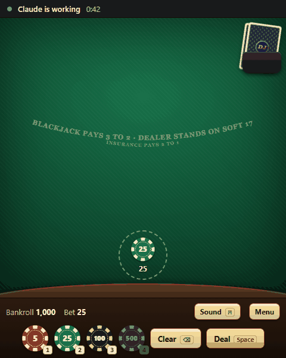
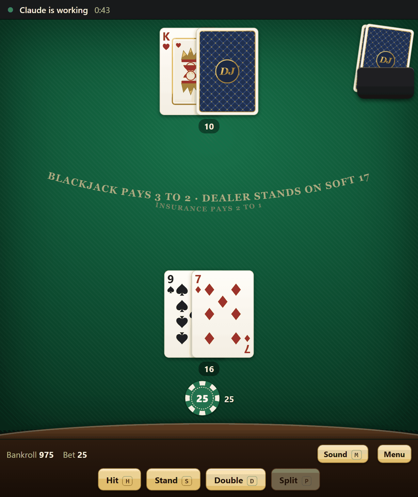
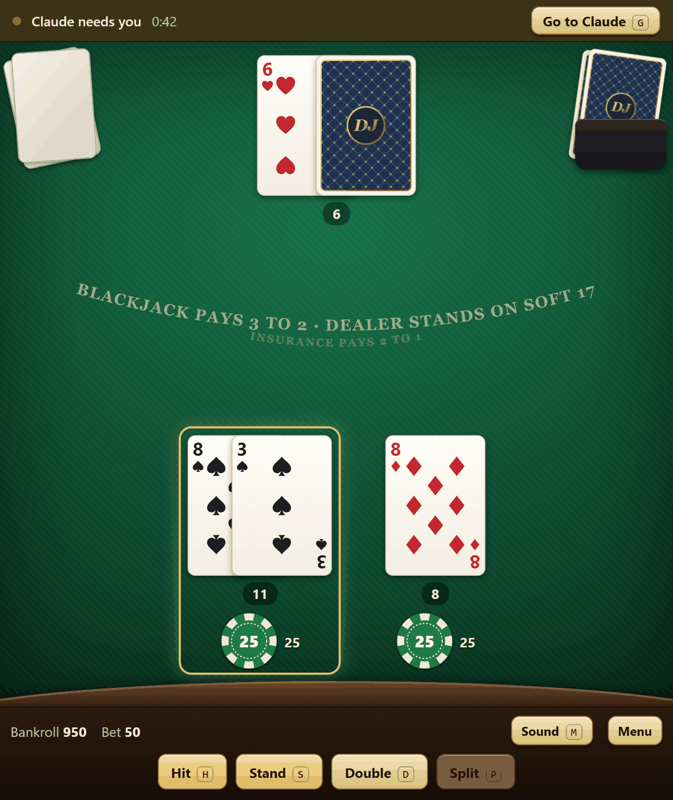

# DevJack

**A Blackjack table that opens beside your editor while Claude Code works, and closes when Claude is done.**
Works with the Claude Code extension for VS Code and with `claude` in the integrated terminal.

> Not affiliated with or endorsed by Anthropic. Play money only. No real gambling.

## How it works

1. Install DevJack. On first start it connects to Claude Code by itself: no restart, no new terminal, nothing to configure.
2. When Claude works on a prompt for more than a couple of seconds, the table opens beside the editor. When Claude needs a permission decision or an answer, the table says so (**Go to Claude**, key `G`).
3. When Claude is done, is interrupted or fails, the table lets you finish your hand, then closes and gives focus back to Claude.

| Claude is working | Claude needs you |
| --- | --- |
|  |  |

Real Blackjack rules: a 6-deck shoe with a cut card, blackjack pays 3:2, the dealer peeks for blackjack and stands on soft 17 (or hits, in the menu), insurance, double down (also after a split), split up to 4 hands. Play money: you start with 1,000 chips, and a free rebuy is always there. Every action has a key, the table reads well in a narrow side panel, and it uses no CPU while it waits.

## What DevJack changes on your machine

- **`~/.claude/settings.json`** (your Claude Code user settings): one hook entry for each of `SessionStart`, `UserPromptSubmit`, `PermissionRequest`, `Notification`, `Stop`, `StopFailure` and `SessionEnd`.
  - Your own hooks and settings are kept. DevJack edits only its own entries, and makes a one-time backup: `settings.json.devjack-backup`.
  - The hook is a single `powershell.exe` call on Windows, or one `sh` line on macOS and Linux. It needs no Node.js and no Git.
  - It does nothing unless a VS Code window with DevJack is running: it checks a heartbeat file and exits at once.
- **`~/.devjack/`**: the heartbeat, a small inbox the hooks write to, and DevJack's state.

DevJack connects once. If you remove its entries, it shows **Disconnected** in the status bar and never adds them back on its own.

## Privacy

- No network access and no telemetry.
- The hooks pass Claude Code's event data to `~/.devjack/inbox` on your machine. DevJack reads it there and deletes it within seconds.
- The content (your prompts, tool input) is never logged and never shown in the table. The table only ever receives status values and numbers.

## Commands

Open the Command Palette and type `DevJack`, or click **♠ DevJack** in the status bar.

| Command | What it does |
| --- | --- |
| **Open Blackjack Table** | Free play. This table never closes by itself. |
| **Simulate Claude Run** | Plays a fake Claude turn through the real pipeline, to see the table in action. |
| **Check Claude Connection** | A report: settings file, hook status, versions, heartbeat, and a self-test of the installed hook. |
| **Connect to Claude Code** / **Disconnect from Claude Code** | Add or remove DevJack's hooks. |
| **Pause Auto-Open** / **Resume Auto-Open** | Pause for an hour, or until VS Code restarts. |
| **Show Log** | The DevJack output channel (event types and routing only). |

## Settings

| Setting | Default | |
| --- | --- | --- |
| `devjack.connectToClaudeCode` | `true` | Connect to Claude Code automatically (once). |
| `devjack.autoOpen` | `true` | Open the table while Claude works. |
| `devjack.openDelaySeconds` | `2.5` | Open only after Claude has worked this long, so quick answers never flash the table. |
| `devjack.closeBehavior` | `afterHand` | `afterHand`: let you finish the hand (at most 60 s). `immediately`. `keepOpen`. |
| `devjack.alertWhenClaudeNeedsYou` | `true` | While the table is open, show a notification with **Go to Claude**. |
| `devjack.sound` | `true` | Short table sounds. `M` mutes in game. |
| `devjack.debugLog` | `false` | More detail in **Show Log**. |

Game options (decks, dealer rule, felt color, four-color deck) and your stats are in the table's **Menu**.

## Keys

`Space` deal · `H` hit · `S` stand · `D` double · `P` split · `I` / `N` take / decline insurance · `1`–`4` add a chip · `Backspace` clear the bet · `M` mute · `G` go to Claude

## Troubleshooting

Start with **DevJack: Check Claude Connection**. It explains what it finds, and its self-test runs the installed hook.

- **The table never opens.**
  - Is the status bar item showing **Disconnected**, or a warning? Run **Connect to Claude Code**.
  - Is auto-open paused, or is `devjack.autoOpen` off?
  - Claude answers in under 2.5 s don't open the table on purpose.
- **"Hooks are switched off".** Your settings contain `disableAllHooks` or `allowManagedHooksOnly`. DevJack doesn't override that.
- **"File problem: invalidJson".** `~/.claude/settings.json` isn't valid JSON. DevJack never touches a file it can't parse: fix the file, then run **Connect to Claude Code**.
- **Windows: "Claude Code is too old".** DevJack needs Claude Code 2.1.139 or later on Windows. Update Claude Code.
- **Claude Code isn't installed yet.** DevJack waits and connects the next time the window gains focus.
- **Cursor, Windsurf, VSCodium.** DevJack isn't on Open VSX yet. Download the `.vsix` from the [GitHub Releases](https://github.com/AvramPaul/VSCode_BlackJack_Exstension/releases) page, then Extensions view → `…` → **Install from VSIX…**.
- **WSL, SSH and Dev Containers.** Install DevJack on the remote side, where Claude Code runs (VS Code does this by default).
- **Two windows with the same folder.** Both may show the table: DevJack matches Claude sessions to windows by folder.
- **I closed the table.** It stays closed until your next prompt.

## Uninstall

Uninstall DevJack from the Extensions view. At the next VS Code restart, it removes its hooks from `~/.claude/settings.json` and deletes `~/.devjack`. To be safe on remotes (WSL, SSH), run **DevJack: Disconnect from Claude Code** before uninstalling.

To remove the hooks by hand, open `~/.claude/settings.json` and delete DevJack's entries:

- **Windows:** entries whose `command` is `powershell.exe` with `-EncodedCommand` in `args`;
- **macOS and Linux:** entries whose `command` ends with `# devjack-hook-v2`;
- **from DevJack 1:** entries whose `command` contains `devjack-hook.cjs`.

Then delete the `~/.devjack` folder. If the hooks stay, they're harmless: they exit at once without DevJack running.

## Disclaimer

DevJack is an independent project. It is not affiliated with or endorsed by Anthropic. "Claude" and "Claude Code" are used only to describe what DevJack works with.

Play money only. No real gambling, no purchases, no prizes.
